<p align="center">
  
</p>

<p align="center">
  
  
  
  
  
  
</p>

<p align="center">
  <b><a href="#legal--clean-room-notice">Legal Notice</a></b> ·
  <b><a href="#highlights">Highlights</a></b> ·
  <b><a href="#how-it-works">How It Works</a></b> ·
  <b><a href="#workspace-layout">Workspace</a></b> ·
  <b><a href="#what-works-today">What Works</a></b> ·
  <b><a href="#quick-start">Quick Start</a></b> ·
  <b><a href="#cli-reference">CLI</a></b> ·
  <b><a href="#testing--verification">Tests</a></b>
</p>

# Strata — No-API Vulkan & Slang Console Compatibility Layer

**Strata** is an experimental, clean-room, open-source compatibility layer written in **Rust** for running unpacked x86-64 console software natively on Windows PCs across **NVIDIA, AMD, and Intel Arc** GPUs—in the spirit of Wine and Proton—without CPU emulation.

Instead of rebuilding legacy Direct3D 12 abstractions on top of console hardware primitives, Strata takes a vendor-agnostic **"No-API" Vulkan 1.3+ (`ash`)** approach paired with a **pure-Rust Direct RDNA2 → SPIR-V 1.6** shader compiler, **subgroup-size-aware Wave64 support** (SIMD8 / SIMD16 / Wave32 / Wave64), and **build-time Slang** runtime shaders.

---

## Legal & Clean-Room Notice

> [!IMPORTANT]
> **Strata is an independent, general-purpose software compatibility research project.**
>
> - **No Target Game:** Strata is **not** tailored to, affiliated with, or endorsed by any specific game, publisher, or console manufacturer. It is a general-purpose runtime and shader-translation architecture.
> - **No Game Files or Copyrighted Data:** This repository contains **source code only**. It does **not** distribute, link to, or provide any game executables, assets, archives, firmware, or copyrighted media.
> - **No Proprietary SDKs or Keys:** This repository contains **zero** proprietary console SDK headers, binaries, import libraries, or encryption keys. All OS/graphics interfaces are independently authored clean-room implementations based on public specifications (AMD RDNA2 ISA, Khronos Vulkan 1.3+ & SPIR-V 1.6, Slang, and Microsoft Win32/PE32+ documentation).
> - **No DRM Circumvention:** Strata operates strictly on **user-supplied, already-unpacked** binaries that the user legally owns. It does **not** download, decrypt, unpack, or bypass DRM or package encryption (XVC / MSIXVC / etc.).
> - **Offline by Design:** Network/telemetry console APIs are stubbed offline by default.

---

## Highlights

<table>
  <tr>
    <td width="33%" valign="top">
      <b>No-API Vulkan 1.3+ (Raw <code>ash</code>)</b><br><br>
      No <code>wgpu</code>/<code>vulkano</code> wrappers, no <code>VkRenderPass</code>, no <code>VkFramebuffer</code>, and no vertex input layouts. Every shader shares <b>one global pipeline layout</b> (128 B push constants for User SGPRs + 1 unbounded bindless descriptor heap) with <code>VK_KHR_dynamic_rendering</code>.
    </td>
    <td width="33%" valign="top">
      <b>Real 64-bit GPU Pointers (BDA)</b><br><br>
      Uses <code>VK_KHR_buffer_device_address</code> (<code>PhysicalStorageBuffer64</code>) so raw memory accesses, constant tables, and BVH node fetches compile to direct pointer loads—eliminating 4 GiB raw-buffer limits and multi-window <code>switch</code> overhead.
    </td>
    <td width="33%" valign="top">
      <b>3-Tier Hybrid Unified Memory</b><br><br>
      Combines <b>Tier 1</b> zero-copy CPU↔GPU memory (<code>VirtualAlloc</code> → <code>VK_EXT_external_memory_host</code>), <b>Tier 2</b> <code>DEVICE_LOCAL</code> GDDR6 mirrors, and <b>Tier 3</b> 64 KiB sparse tiled image aliasing (<code>vkQueueBindSparse</code>).
    </td>
  </tr>
  <tr>
    <td width="33%" valign="top">
      <b>Direct RDNA2 → SPIR-V 1.6 (Pure Rust)</b><br><br>
      Zero runtime HLSL text generation, zero DXC compile stalls, and zero <code>dxil.dll</code> signing. Includes SSA optimization (bitcast cancellation, CSE, DCE, <b>128-bit BDA load coalescing</b>), structured CFG (<code>OpSelectionMerge</code>/<code>OpPhi</code>), and atomic disk caching.
    </td>
    <td width="33%" valign="top">
      <b>Multi-Vendor Wave64 Support (NVIDIA · AMD · Intel Arc)</b><br><br>
      Backward whole-live mask liveness keeps lane-local masks in registers while subgroup-size-aware ballots (<code>OpGroupNonUniformBallot</code>, <code>OpAtomicOr</code>, <code>subgroupSizeControl</code>) handle <b>Intel Arc SIMD8/16</b>, <b>NVIDIA &amp; AMD RDNA Wave32</b>, and <b>AMD native Wave64</b> seamlessly.
    </td>
    <td width="33%" valign="top">
      <b>Build-Time Slang Runtime Shaders</b><br><br>
      Internal GPU compute and presentation passes (64 KiB dirty-page hashing, Morton texture detiling, batched indirect-draw clamping, BVH differential oracle, vertex-less fullscreen present) are written in <b>Slang</b> using <code>Ptr&lt;T&gt;</code> and generics, compiled offline in <code>build.rs</code>.
    </td>
  </tr>
</table>

---

## How It Works

```text
  User-supplied unpacked x86-64 PE32+ executable
                       │
                       ▼
  ┌─────────────────────────────────────────────────────────────────────┐
  │  strata-hle (PE32+ Mapper, Relocations, IAT, Static TLS, VEH)     │
  │  - Native x86-64 CPU execution (no CPU emulation)                   │
  │  - Zen 2 instruction VEH (clwb, clzero, rdpru, monitorx, rdpid)     │
  │  - Clean-room thunks (xmem, d3d12_xs, xg_xs, DStorage, offline GDK) │
  └─────────────────────────┬───────────────────────────────────────────┘
                            │ D3D12.X COM vtables (ThinCommandList)
                            ▼
  ┌─────────────────────────────────────────────────────────────────────┐
  │  strata-gpu (No-API Vulkan 1.3+ via raw `ash`)                    │
  │  - 3-Tier UMA: ExternalMemoryHost + GDDR6 Mirrors + 64 KiB Sparse   │
  │  - Fence-gated Bindless Slot Manager + Batched Indirect Clamping    │
  │  - VK_KHR_dynamic_rendering + Win32 VK_KHR_swapchain Presenter      │
  └─────────────────────────┬─────────────────────────┬─────────────────┘
                            │                         │
                            ▼                         ▼
  ┌──────────────────────────────────────┐  ┌───────────────────────────┐
  │  strata-shader (Pure Rust)         │  │  strata-runtime-shaders │
  │  XBCH (zlib) -> FSSM -> RDNA2 Decode │  │  Build-time Slang -> SPV  │
  │  -> SSA -> Opt (128b Coalesce)       │  │  - dirty_hash.slang       │
  │  -> Wave64-on-32 -> Direct SPIR-V 1.6│  │  - detile.slang           │
  │  -> Atomic Disk Cache                │  │  - clamp_indirect.slang   │
  └──────────────────────────────────────┘  │  - bvh_oracle.slang       │
                                            │  - present_blit.slang     │
                                            └───────────────────────────┘
```

---

## Workspace Layout

| Crate | Purpose |
| :--- | :--- |
| [`crates/strata-shader`](crates/strata-shader) | Pure-Rust RDNA2 decoder, SSA IR, optimizer (bitcast cancellation, CSE, DCE, 128-bit BDA load coalescing), Wave64 liveness, `DXBC`/`XBCH` (zlib)/`FSSM` container parser, CPU BVH reference, atomic SPIR-V disk cache, and direct SPIR-V 1.6 (`PhysicalStorageBuffer64`) emitter. |
| [`crates/strata-runtime-shaders`](crates/strata-runtime-shaders) | Emulator-authored internal shaders written in **Slang** (`Ptr<T>`, generics, wave intrinsics) compiled offline via `slangc` in `build.rs` and embedded as SPIR-V 1.6 byte slices. |
| [`crates/strata-gpu`](crates/strata-gpu) | Raw `ash` No-API Vulkan 1.3+ engine: capability probe, single global bindless + push-constant layout, 3-tier `UmaManager`, 64 KiB `SparseTilePool`, fence-gated `BindlessManager`, `ThinCommandList`, `FramePacingClock`, Win32 `SwapchainPresenter`, and live BDA `ComputeRunner`. |
| [`crates/strata-hle`](crates/strata-hle) | Zero-dependency PE32+ parser/mapper (sections, DIR64 relocations, IAT, exports, static TLS), Zen 2 VEH emulator, `PhysicalPagePool` scatter mapper, VFS drive rewriter, `LoadLibrary`/`GetProcAddress` hooks, offline `DStorage`/GDK stubs, `xg_xs` swizzle layout computer, input mapper, and `d3d12_xs` COM vtables. |
| [`crates/strata-cli`](crates/strata-cli) | Command-line tool for GPU capability probing, self-tests, live GPU & UMA hardware verification, and PE32+ import/mapping diagnostics. |

---

## What Works Today (Experimental Prototype)

Strata is an early-stage research prototype. Subsystems below are verified on synthetic unit tests, `spirv-val --target-env vulkan1.3`, and live Vulkan 1.3 GPU hardware tests—**not** yet full retail console games.

<details>
<summary><b>Shader Compiler & Slang Runtime Shaders</b></summary>

| Component | Status | Verified By / Current Scope |
| :--- | :---: | :--- |
| RDNA2 decoder (`SOPP`/`SOPC`/`SOP1`/`SOPK`/`SOP2`, `VOP1`/`VOPC`/`VOP2`/`VOP3`, `SMEM`, `FLAT`/`GLOBAL`, `DS`, `MUBUF`/`MTBUF`, `MIMG`, `EXP`) | 🟡 | Unit tests; covers core compute/ALU/memory/ray-tracing encodings (not full 400+ opcode ISA yet) |
| Direct RDNA2 → SSA → SPIR-V 1.6 (BDA, LDS, VOP3, BVH64) | 🟡 | `spirv-val` + live GPU execution on synthetic RDNA2 compute kernels; graphics `EXP`/bindless `MIMG` return explicit errors |
| 128-bit BDA load coalescing & bitcast/CSE/DCE opt | ✅ | Unit test + live GPU execution |
| RDNA2-translated Structured CFG (`s_and_saveexec_b64` + `s_cbranch_execz` → `OpSelectionMerge` + `OpPhi`) | 🟡 | `spirv-val` + live GPU divergent-lane execution (forward branches; loops/irreducible CFG return explicit errors) |
| RDNA2-translated Wave64 ballot (`wave.rs` whole-live analysis → `OpGroupNonUniformBallot` + Workgroup atomic merge) | ✅ | `spirv-val` + live GPU test across hardware subgroup sizes (`0x5555555555555555`) |
| `DXBC` / `XDAT` / `XBCH` (pure-Rust RFC 1950/1951 zlib) / `FSSM` parser | ✅ | Unit tests on synthetic containers & streams |
| Atomic content-addressed SPIR-V disk cache | ✅ | Roundtrip unit test |
| Build-time Slang shaders (`dirty_hash`, `detile`, `clamp_indirect`, `bvh_oracle`, `present_blit`) | ✅ | Compiled by `slangc` in `build.rs` + live GPU execution |

</details>

<details>
<summary><b>No-API Vulkan 1.3+ GPU Backend & 3-Tier Hybrid UMA</b></summary>

| Component | Status | Verified By / Current Scope |
| :--- | :---: | :--- |
| Tier 1 Zero-Copy Host UMA (`VirtualAlloc`/`mmap` → `VK_EXT_external_memory_host` → 64-bit BDA) | ✅ | Live GPU read/write test (0 `memcpy`, 64/64 lanes) |
| Tier 2 `DEVICE_LOCAL` GDDR6 VRAM Mirror + Cross-Tier GPU execution | ✅ | Live GPU test reading Tier 2 VRAM → writing Tier 1 CPU RAM |
| Tier 3 `vkQueueBindSparse` 64 KiB Aliased 2D `VkImage`s | ✅ | Live GPU sparse bind test (2 `SPARSE_ALIASED` images sharing 1 tile) |
| No-API `VK_KHR_dynamic_rendering` + Slang vertex-less `present_blit.slang` | ✅ | Live GPU render test (0 RenderPasses, 0 Framebuffers, 0 VertexBuffers) |
| Fence-gated Bindless Slot Manager (`SHOW_AFTER` pattern) | ✅ | Unit test |
| `ThinCommandList` (bind deduplication, integer-RT blend sanitization, hoisted clamps, draw/barrier/copy commands) | ✅ | Unit test + live COM → Vulkan compute execution |
| `FramePacingClock` + Win32 `Win32Window` / `SwapchainPresenter` + atomic `VkPipelineCache` | 🟡 | Windows x64 only today; Linux X11/Wayland surface support planned |

</details>

<details>
<summary><b>PE32+ Loader & Console HLE</b></summary>

| Component | Status | Verified By / Current Scope |
| :--- | :---: | :--- |
| PE32+ parser & in-memory mapper (`VirtualAlloc`, DIR64 relocations, live IAT patching, R/W/X protections, real entry-point execution) | ✅ | Unit test executes real mapped x86-64 PE32+ entry point (`strata-cli run <exe>`) |
| Static TLS slot allocation (`TlsAlloc`) + template initialization | 🟡 | Basic slot setup; full TEB `ThreadLocalStoragePointer` multi-thread injection in progress |
| Live Windows VEH (`clzero`, `rdpru` via QPC, `rdpid` via `GetCurrentProcessorNumber`, `monitorx`/`mwaitx`, `clwb`) | ✅ | Unit tests (note: `clwb`/`rdpid` are also present on modern Intel CPUs; VEH catches faults on older/non-AMD CPUs) |
| `xmem.dll` (`XMemVirtualAlloc`, `XMemFree`, physical-page pool & scatter mapping, working-set stats, `XMemTransferMemory`) | 🟡 | Wired to `UmaManager` + `PhysicalPagePool`; partial console flag coverage |
| `d3d12_xs.dll` COM vtables (`Device`, `Queue`, `CommandList`, `Resource`, `Fence`, `ID3DBlob`) & `xg_xs.dll` (`XGTextureAddressComputer`) | 🟡 | Unit tests + synthetic GPU compute dispatch; full retail vtable slot parity in progress |
| Audio (`xapu.dll` / `AcpHal.dll`) & unimplemented console imports | 🟡 | Offline silent audio stubs + logged `E_NOTIMPL` fallback stubs for unresolved imports |

</details>

---

## Quick Start

### Requirements
- **OS:** Windows 10 / 11 x64
- **Toolchain:** Rust (Edition 2024, MSVC target) + Visual Studio C++ Build Tools
- **SDK:** [Vulkan SDK](https://vulkan.lunarg.com/) 1.3+ (provides `slangc.exe` for build-time Slang compilation and `spirv-val.exe` for shader validation tests)
- **GPU:** **NVIDIA**, **AMD**, or **Intel Arc** Vulkan 1.3+ GPU supporting `bufferDeviceAddress`, `descriptorIndexing`, `dynamicRendering`, `sparseResidencyImage2D`, and `VK_EXT_external_memory_host` (SIMD8 / SIMD16 / Wave32 / Wave64 supported)

### Build & Run Tests

```powershell
# Run all unit tests (includes slangc compilation and spirv-val validation)
cargo test --workspace

# Inspect your GPU's No-API Vulkan 1.3+ capabilities
cargo run -p strata-cli -- probe

# Run all 9 live GPU tests (BDA, Slang shaders, Zero-Copy UMA, Dynamic Rendering, Wave64-on-32)
cargo run -p strata-cli -- gpu-test

# Run live 3-Tier Hybrid UMA test (Zero-Copy Host + GDDR6 Mirror + vkQueueBindSparse)
cargo run -p strata-cli -- uma-test
```

---

## CLI Reference

```powershell
strata-cli probe                   # Query GPU No-API Vulkan 1.3+ features & subgroup size
strata-cli selftest                # Verify embedded Slang SPIR-V & direct RDNA2 -> SPIR-V emitter
strata-cli gpu-test                # Run 9 live GPU tests (RDNA2 BDA, Slang, Zero-Copy UMA, Wave64-on-32)
strata-cli uma-test                # Run live 3-tier hybrid UMA + vkQueueBindSparse test
strata-cli inspect <path.exe>          # Parse PE32+ headers and classify all DLL imports
strata-cli bind-check <path.exe>       # Dry-run IAT resolution against Strata HLE + Host Windows
strata-cli map-test <path.exe> [--execute] # Map PE32+, patch IAT, init TLS (+ optional entry exec & synthetic COM check)
strata-cli run <path.exe>              # Map PE32+, patch IAT, install VEH, and execute the entry point
```

---

## Testing & Verification

Strata uses a **differential, hardware-in-the-loop verification strategy**:
1. **Static SPIR-V Validation:** Every SPIR-V binary emitted by `strata-shader` is validated against Khronos `spirv-val --target-env vulkan1.3`.
2. **Differential GPU Oracles:** Complex algorithms (such as watertight RDNA2 `image_bvh64_intersect_ray` box32 sorting and `64KB_S` Morton detiling) are implemented in both pure Rust CPU reference code and Slang GPU shaders, then executed live on the GPU and compared bit-for-bit.
3. **Zero-Copy & Sparse Hardware Tests:** `gpu-test` and `uma-test` exercise `VK_EXT_external_memory_host`, `DEVICE_LOCAL` BDA mirrors, `VK_KHR_dynamic_rendering`, `vkQueueBindSparse`, and `Wave64-on-Wave32` directly on real Vulkan 1.3+ silicon.

---

## License & Provenance

Dual-licensed under **MIT OR Apache-2.0**.

Strata is an independent clean-room implementation. No code was copied from GPL-licensed compatibility layers or proprietary SDKs. All architectural references are strictly public specifications (Khronos Vulkan / SPIR-V, AMD RDNA2 ISA, Slang, and Microsoft PE32+/Win32 documentation).
